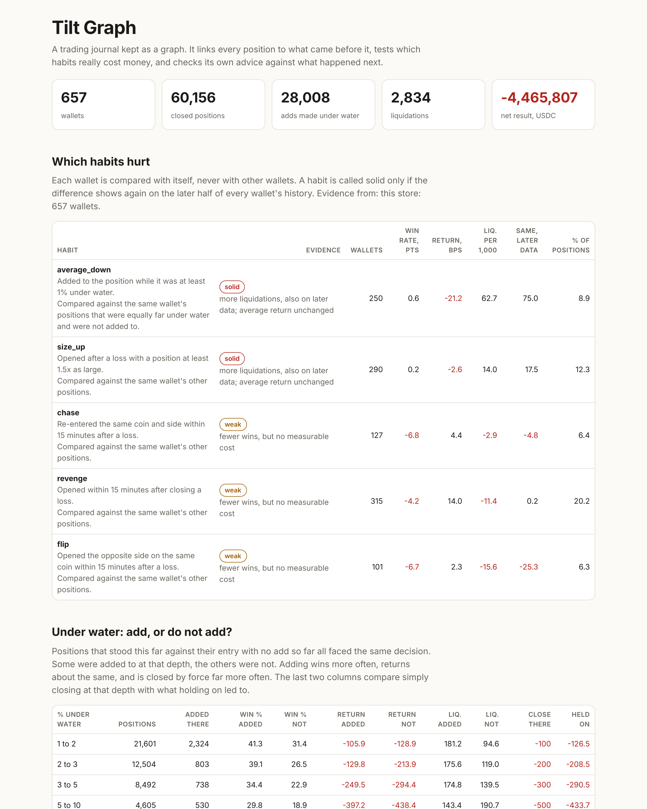

# Tilt Graph

**A trading journal as a graph that an agent asks before the next trade, and that checks its own advice.**

## Use case

Every trader has heard the rules: do not revenge trade, do not add to a loser. Tilt Graph does
not repeat them. It tests them. It reads public Hyperliquid fills, folds them into positions,
links every position to what had just happened before it, and keeps everything in one
[Relate](https://relatedb.ai) file. Then it does three things:

1. **It grades each habit on evidence.** Every habit is tested wallet by wallet, and again on
   later data the rule had never seen. The grade is stored on the habit's node in the graph.
2. **It answers one question before a trade:** would this trade be one of the habits that
   really cost something? The answer is `GO`, `WAIT` or `UNKNOWN`, with the numbers and the
   Cypher behind it.
3. **It audits itself.** The advice is replayed on the later half of every wallet and stored
   next to what actually happened, so anyone can query how good the advice was.

Entry for the [Relate by Neo4j Hackathon](https://relate.devpost.com/).

**Live page:** https://kingthree7.github.io/tilt-graph/ · **Ask the graph in your browser:** https://kingthree7.github.io/tilt-graph/try.html · **Demo video (2 minutes):** https://youtu.be/JKPry4AxsOo



## How it uses Relate

- **Mode: single file** (`.rl`), embedded in the Python process. The same graph also runs
  **in the browser** (Relate compiled to WebAssembly) on the
  [try page](https://kingthree7.github.io/tilt-graph/try.html), with the same Cypher.
- **Why this mode:** a trading journal is private and should be one thing you can copy, back up
  or delete. Nothing is deployed, nothing leaves the machine except the request for public
  fills, and an agent opens the same file read-only.
- **What the graph models:** wallets, their closed positions, what each position was opened
  after, loss spirals, ladders of adds under water, habits with their tested evidence, wallets
  that behave alike, and the guard's replayed advice next to what happened.

A trade history is usually a table, and a table answers "how much did I lose". The questions
that matter here are about what is connected to what:

```
(:Wallet)-[:TRADED]->(:Position)-[:ON]->(:Coin)
(:Position)-[:OPENED_AFTER {gap_min, size_ratio}]->(:Position)    what had just closed
(:Position)-[:TILTED_FROM]->(:Position)                           opened within 30 min after that loss
(:Position)-[:OPENED_IN]->(:State)                                the situation it was opened in
(:Position)-[:SHOWS]->(:Pattern {grade, ...})                     the habit, with its evidence
(:Position)-[:AVERAGED_DOWN]->(:Add)-[:THEN]->(:Add)              the ladder of adds under water
(:Wallet)-[:HAS_HABIT {positions, win_pct, pnl}]->(:Pattern)
(:Wallet)-[:PEER_OF {score}]->(:Wallet)                           nearest by habit vector
(:Position)-[:GUARD_SAID {because}]->(:Verdict)                   the advice, next to the outcome
(:Position {moment})                                              the situation at the open, as a vector
(:Question {name, title, cypher})                                 the prepared questions, full-text indexed
```

What Relate does for us that a table would not:

- **The guard is a walk, not a model.** One check goes wallet → last closed position → the
  habit the planned trade would be → the evidence on that habit → how it went for this wallet
  → how it went for its peers → the chain of losses it may already be in → how the advice
  itself did → the most similar moments in the store. That is eight steps through connected
  context, and each one is a line of Cypher that is returned with the answer.
- **Spirals are paths.** A loss chain is `(last)-[:TILTED_FROM]->*(first)`. One quantified
  path pattern finds chains of any length.
- **Ladders are paths too.** Each add under water is a node, linked in order, so "how deep did
  this trader go before it ended" is a traversal.
- **Peers come from vector search inside the same file.** Every wallet has an 8-number habit
  vector; a Relate vector index finds the nearest wallets, and the result is written back as
  `PEER_OF` edges. Similarity and structure are queried together in one statement.
- **Similar moments come from a second vector index.** Every position carries seven numbers
  that describe the moment it was opened in (what had just closed, how long ago, size against
  it, same coin and side, losses in a row). One statement finds the nearest moments with
  `SEARCH p IN (VECTOR INDEX position_moment FOR $v WHERE p.closed_at <= $now LIMIT 200)`, so
  the filter runs inside the index and nothing from the future leaks in, and then walks on to
  the habits those positions showed. The guard reports this as a description and never turns
  it into a verdict.
- **The questions are data too.** The prepared questions are `Question` nodes under a
  full-text index, so an agent finds the right one with a few words.
- **Evidence and audit live in the graph.** Grades sit on `Pattern` nodes and replayed advice
  on `GUARD_SAID` edges, so the tool's claims are data that can be queried, not text in a README.
- **Embedded and one file.** A trading journal is private. Nothing is deployed, nothing leaves
  the machine except the request for public fills, and the journal can be copied or deleted
  like any file. An agent opens it read-only.

## Setup and run

Python 3.9 or later. No key, no account, no server.

```bash
git clone https://github.com/KingThree7/tilt-graph && cd tilt-graph
pip install -e ".[mcp]"

# the cohort of real wallets (unpacks examples/cohort.rl.gz on first use)
tiltgraph view     -d examples/cohort.rl -o tilt.html     # one self-contained HTML page
tiltgraph evidence -d examples/cohort.rl                  # the tests behind every grade

# the made-up single trader
tiltgraph report -d examples/demo.rl
tiltgraph guard  -d examples/demo.rl --at 1790702290558 --coin ETH --side short \
                 --notional 9000 --adding-to-loser
```

The last command answers:

```
WAIT: This trade would be 'average_down': Added to the position while it was at least 1% under
water. Tested on 250 wallets, against the same wallet's positions that were equally far under
water and were not added to: +63 liquidations per 1,000 positions (+75 on later data), with no
reliable change in average return (-21 basis points). More small wins, more blow-ups. You did
this 34 times: total result -2387.11.
```

The same answer also carries `similar_moments`: the positions in the store that were opened in
the most similar situation, and how those ended.

The browser page is built from the example store with `tiltgraph web -d examples/demo.rl -o docs`.
It exports the graph as JSON and loads it into Relate WebAssembly; open `docs/try.html` through
any static server (`python -m http.server -d docs`).

With your own address (fills on Hyperliquid are public):

```bash
tiltgraph ingest 0xYOUR_ADDRESS --days 60 -d mine.rl
tiltgraph view  -d mine.rl -o mine.html
tiltgraph guard -d mine.rl --coin HYPE --side long --notional 500 --live
```

`--live` looks up your open position and decides by itself whether the planned trade would add
to a loser. A single wallet is too small to test anything, so `mine.rl` carries the cohort's
evidence on its habit nodes and says where it came from. `ingest` can be run again at any
time; it updates the same store and never duplicates.

### As memory for an agent

```bash
tiltgraph serve -d examples/cohort.rl      # MCP over stdio, the store is opened read-only
```

| Tool | What the agent gets |
|---|---|
| `pre_trade_check` | `GO`, `WAIT` or `UNKNOWN` for a planned trade, with evidence, the wallet's own history, its peers, and the guard's track record |
| `habits` | which habits a wallet has and what they did for it |
| `peers` | the wallets that behave most like it (vector search over habit vectors) and how they ended |
| `spirals` | its worst chains of losses |
| `similar_moments` | the moments most like this one (vector search over `Position.moment`) and how they ended, for all wallets and for this wallet |
| `find_question` | the prepared question that fits a few words (full-text search) |
| `ask`, `schema`, `read_cypher` | prepared questions, the shape of the graph, and free read-only Cypher |

[`examples/order_gate.py`](examples/order_gate.py) is the smallest useful agent: it runs the
check and holds the order back unless the answer is `GO`. It never places an order.
[`AGENTS.md`](AGENTS.md) tells an agent what the graph means and how to speak about it.

## Where the data lives

| Store | Path | What it holds |
|---|---|---|
| Example trader | `examples/demo.rl` | one made-up trader, 137 positions, opens directly |
| Cohort | `examples/cohort.rl.gz` | 657 real wallets under aliases, 60,156 positions. Gzipped because it is 82 MB unpacked; any `tiltgraph` command unpacks it to `examples/cohort.rl` on first use, or run `gunzip -k examples/cohort.rl.gz` |
| Browser copy | `docs/demo-graph.json` | the example trader exported for the WebAssembly page, 256 nodes and 792 relationships |

The first two are Relate single-file stores. Open them read-only with `relate.connect(path, read_only=True)`
or through `tiltgraph serve`.

## What the data said

The bundled cohort store holds 657 public wallets over 60 days: 60,156 closed
positions, 2,834 liquidations. Wallets appear under aliases only. We expected to confirm
the usual rules. Most of them did not survive.

| Habit | Compared with the same wallet's other positions | Grade |
|---|---|---|
| **Revenge**: opened within 15 min after a loss | 4.2 points fewer wins, return not lower (+14 bps), not more liquidations | weak: fewer wins, no measurable cost |
| **Chase**: same coin, same side, right after a loss | 6.8 points fewer wins, return unchanged (+4 bps) | weak |
| **Flip**: same coin, other side, right after a loss | 6.7 points fewer wins, return unchanged (+2 bps) | weak |
| **Size up**: at least 1.5x as large after a loss | return unchanged (-3 bps), +14 liquidations per 1,000 (t = 3.1), +18 on later data | solid: more liquidations |
| **Average down**: add at least 1% under water | see the fair test below: return unchanged, +63 liquidations per 1,000 (t = 5.3), +75 on later data | solid: more liquidations |

Two things stood out.

**Revenge trading is mostly a myth in this data.** Positions opened within 15 minutes after a
loss win a little less often, but they do not earn less. Pooled over all wallets they look
terrible, because wallets that trade fast are worse wallets. Inside one wallet the effect is
gone. A tool that says "wait 15 minutes" would have warned for nothing.

**Adding to a loser is not what it looks like either.** Positions with an add under water are
8.9% of all positions and 86.9% of the net loss. That number is true
and it is misleading: only positions that went against the trader can be added to. So we built
the fair test. With price candles we find, for every position, the moment it was 1 to 2% under
water, and compare the ones that were added to with the ones that were not, inside the same
wallet:

| At 1 to 2% under water | Positions | Won | Average return | Liquidated per 1,000 |
|---|---|---|---|---|
| Added there | 2,324 | 41.3% | -106 bps | 181 |
| Did not add | 19,277 | 31.4% | -129 bps | 95 |
| Difference inside the same wallet (250 wallets) | | | -21 bps (t = -1.4, not reliable) | +63 (t = 5.3) |

Adding wins more often and earns about the same on average. It also about doubles the chance
of a liquidation. It is a trade of many small wins against rare large losses. That is the one
thing the guard warns about, together with sizing up after a loss, and it says exactly that.

**The audit.** The rule was learned on the first half of every wallet and replayed on the
second half:

| The guard would have said | Positions | Won | Average return | Liquidated per 1,000 |
|---|---|---|---|---|
| `WAIT` (it added under water) | 1,284 | 40.6% | -104 bps | 198 |
| `GO` (equally deep, no add) | 11,796 | 30.3% | -135 bps | 99 |

The audit says the same as the test, on data the rule had not seen: where the guard said
`WAIT`, twice as many positions were liquidated, and the average return was no worse. So the
guard does not claim that adding loses money. It claims that adding raises the risk of ruin,
and that claim held.

Where the money went: liquidated positions are 4.7% of all positions and 51% of the net loss
(-2.26M of -4.47M USDC). 419 of 657 wallets were liquidated at least once. Fees were 15%.

Reproduce every number: `tiltgraph evidence -d examples/cohort.rl`.

## The made-up trader

`examples/demo.rl` holds a trader we generated ([`tiltgraph/sample.py`](tiltgraph/sample.py),
fixed seed), written as fills in the exact shape Hyperliquid returns, so it runs through the
same code as a real address. The tests need a known truth: the generated trader re-enters fast
after losses and builds ladders under water, and the tests check that the graph finds both
again from the fills alone. Rebuild it with `tiltgraph sample -d examples/demo.rl`.

## How the cohort was built

`tiltgraph cohort` draws wallets at random from the public Hyperliquid leaderboard file
(account value 300 to 50,000 USDC, real activity, no market makers by turnover), fetches 60
days of fills, keeps wallets with at least 20 closed positions and stores them under salted
aliases. The addresses are not in the store. The draw is random, not a list of winners:
191 of 657 wallets ended the 60 days in profit.

## Tests

```bash
pip install -e ".[test,mcp]" && pytest
```

Eighteen tests: folding fills into positions (adds, reversals inside one fill, positions that
began before the window, spot fills), adds under water and their ladders, idempotent writes,
`OPENED_AFTER` always pointing at the right position, the planted habits found again, the
decision-point test, the three verdicts, similar moments from the vector index without looking
ahead, full-text search over the questions, the export for the browser page, and the MCP server refusing to write.

## Limits

- Sixty days and one venue. A habit that is harmless here may not be harmless in another market phase.
- The tests compare inside a wallet and on later data. That removes the largest biases; it does
  not make the result a controlled experiment.
- The decision-point test needs candles. 41,193 of 60,156 positions have them;
  the worst move is measured on 15-minute candles, so very short positions are coarse.
- A position counts once it is closed. Funding payments are not in fills and are not counted.
- The habits describe timing and size. They do not know why a trade was opened.
- `UNKNOWN` is a real answer. The guard does not turn thin evidence into advice.
- This describes past behaviour. It predicts no price and is not trading advice.

## How it was built

Built for the hackathon, started on 22 November 2026. Tools: Relate 1.2.0 (`relate-db` and `@relate/relate-wasm`), the
Python standard library, the public Hyperliquid info API, the MCP Python SDK, pytest.
**AI use:** the code, tests and this README were written with Claude (Anthropic) as a coding
assistant, directed and reviewed by the author. Every number above comes from running the code
on the bundled stores.

MIT License.
